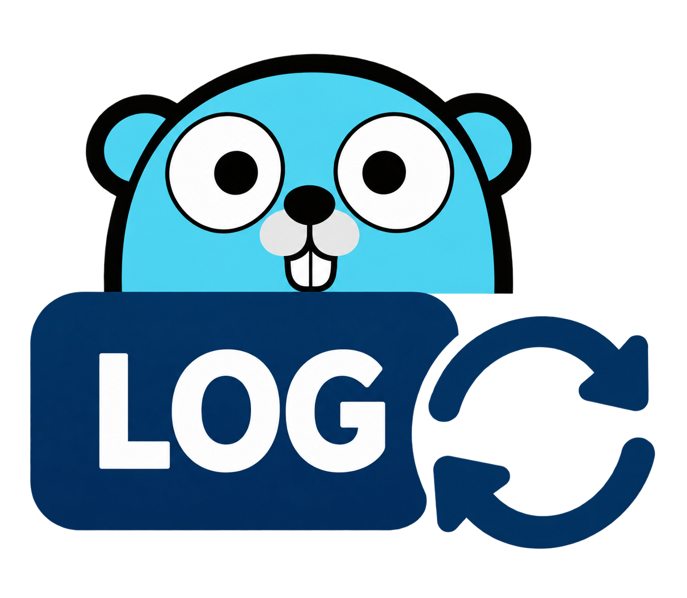

# logrotate

[](https://pkg.go.dev/github.com/mapleafgo/logrotate/v2)
[](https://github.com/mapleafgo/logrotate/actions/workflows/ci.yml)

为 Go 应用提供按自然日和文件大小轮转的日志写入器，支持 gzip 归档、自动保留清理和可选的并发异步写入。实现仅依赖 Go 标准库，可用作 `log/slog` 的输出。

## 安装

需要 **Go 1.26 或更高版本**。v2 目前为预发行版，请以[发布记录](https://github.com/mapleafgo/logrotate/releases)中的最新预发行版本替换下例版本号：

```sh
go get github.com/mapleafgo/logrotate/v2@v2.0.0-rc.4
```

## 快速开始

下面的示例将一条 JSON 日志写入 `logs/app.log`，并在退出前显式同步和关闭文件：

```go
package main

import (
	"errors"
	"log"
	"log/slog"

	"github.com/mapleafgo/logrotate/v2"
)

func main() {
	w, err := logrotate.Open(logrotate.Config{
		Filename:        "logs/app.log",
		Daily:           true,
		MaxFileMiB:      128,
		HistoryDays:     7,
		TotalArchiveMiB: 2048,
		Compress:        true,
	})
	if err != nil {
		log.Fatal(err)
	}

	slog.New(slog.NewJSONHandler(w, nil)).Info("application started")

	syncErr := w.Sync()
	if err := errors.Join(syncErr, w.Close()); err != nil {
		log.Fatal(err)
	}
}
```

`slog.Info` 不返回写入错误。若需要逐次检查写入结果，请直接调用 `Write` 并处理其返回值。

## 配置

| 字段 | 零值 | 行为 |
| --- | --- | --- |
| `Filename` | 无效 | 活动日志路径，必填；不接受符号链接或 `..` 路径段。 |
| `Daily` | 关闭 | 跨自然日后的首次非空写入触发切卷。 |
| `MaxFileMiB` | 不限 | 非空文件追加后将超过此大小时，先切卷再写入。 |
| `HistoryDays` | 不限 | 按归档日期保留最近 N 个自然日，包含今天。 |
| `TotalArchiveMiB` | 不限 | 正式归档总量上限，不含活动文件和待压缩文件。 |
| `Compress` | 关闭 | 将新封存的卷独立压缩为 gzip。 |

大小单位为 MiB（1 MiB = 1,048,576 字节）。日期以进程本地时区为准。按日与按大小可以组合；没有写入时不会定时切卷。单次写入不拆分，超大记录可能让活动文件超过大小阈值。

## 并发、同步与退出

- **单 goroutine 写入**：直接使用 `Open` 返回的 `Writer`。并发写入时用 `OpenAsync(w, AsyncConfig{})` 包装；包装成功后由异步 writer 独占并关闭底层。活动文件和归档目录不得与其他 writer 或外部轮转工具共用。
- **异步队列**：`AsyncConfig.QueueSize` 按写入条数而非字节计，非正数使用默认值 1024。默认队列满时阻塞。显式选择 `FullDropNewest` 时，满队列拒收当前记录并返回 `ErrDropped`，丢弃条数由 `Dropped()` 累计。异步 `Write` 成功只表示已入队；返回后可复用传入的缓冲区。`LastError()` 返回最近一次后台写入或同步结果，后续成功会将其清空。
- **显式同步**：异步 `Sync()` 等待屏障前已入队的记录交付，再同步底层。`Writer.Sync()` 只同步当前活动文件，不保证新建路径的目录项持久化，也不等待归档维护。
- **正常退出**：先停止日志生产者；需要确认持久化时，显式调用并检查 `Sync()`。无论同步是否成功都应调用并检查 `Close()`。关闭会排空已接收的异步记录并等待归档维护收尾，不隐式同步、不设超时。`AsyncWriter` 保留首个后台写入错误，后续 `Sync()` 与 `Close()` 都会返回它；关闭后的写入返回 `ErrClosed`，也可用 `errors.Is` 匹配 `fs.ErrClosed`。

使用相对路径时，关闭前不要改变进程工作目录。新活动文件默认权限为 `0600`；替换文件和压缩归档沿用源文件的权限位，受 umask 限制。

## 归档与保留

归档位于 `Filename + ".archives"`，命名为 `YYYY-MM-DD.N`，压缩后加 `.gz`。启动和切卷会触发独立的后台归档维护；正式归档发布前保留待压缩原件，重启后可恢复，当前关闭轮转也不影响启动恢复。

后台先删除过期卷，再按从旧到新的顺序满足容量上限；两项限制可独立启用。容量上限不是磁盘硬配额。活动文件重开失败时会保护刚封存的卷，待重开成功后重新评估；若不可删除卷已超过容量上限，停止容量清理并报告错误。

维护失败通过 `Writer.MaintenanceError()` 或 `Close()` 报告，不计入 `AsyncWriter.LastError()`。没有新维护通知时，按 1、2、4 秒最多重试三次；关闭不等待尚未触发的重试。

## 从旧版升级

切换到带 `/v2` 的 import 路径，将旧大小字段改名（`MaxFileSizeMB` → `MaxFileMiB`，`MaxTotalSizeMB` → `TotalArchiveMiB`），数值不变；按下表迁移 `MaxDays`。`MaxBackups` 没有按份数的一对一替代。停止旧 writer 并关闭后，再打开同一活动路径。v2 不读取、迁移或删除旧归档；请单独安排旧归档清理并更新采集规则。活动文件和归档目录由单个 writer 独占，不与外部轮转工具混用。

| 旧版配置 | v2 配置 |
| --- | --- |
| `Daily: true`，`MaxDays: N`（`N > 0`） | `HistoryDays: N+1`。旧版保留今天及之前 N 个自然日，v2 的天数已包含今天。要保留相同的日期边界，请沿用旧版的本地时区。 |
| `Daily: false`（纯按大小轮转） | `HistoryDays: 0`。旧版纯大小模式不应用 `MaxDays`；v2 即使关闭 `Daily`，正数 `HistoryDays` 也会按日期清理归档。 |
| `MaxDays: 0` | `HistoryDays: 0`，关闭按日期清理，不影响容量限制。 |

### 回滚到旧版

1. 停止日志生产者，关闭 v2 writer 并检查 `Close` 的返回值，确认没有 writer 仍在写入或维护归档；若报错，先核对活动文件和待处理归档。
2. 备份当前活动文件、旧归档与整个 `Filename + ".archives"` 目录（含待处理卷）。单独保留 v2 归档，不要改名为旧格式、混入旧归档或覆盖当前活动文件。
3. 恢复升级前的应用构建（原依赖版本、不带 `/v2` 的 import 路径及旧配置）和旧版采集规则。启动旧 writer 接管同一活动路径，确认新日志能写入、切卷并被采集；v2 归档通过独立规则采集或留存，不会自动转回旧格式。

## 更多文档

- [Go API 参考](https://pkg.go.dev/github.com/mapleafgo/logrotate/v2)
- [发布记录](https://github.com/mapleafgo/logrotate/releases)
- [项目文档索引](docs/README.md)

## 许可证

代码采用 [MIT License](LICENSE)。Logo 参考了 [Renée French 创作的 Go Gopher](https://go.dev/blog/gopher)，其原始形象采用 CC BY 4.0。
